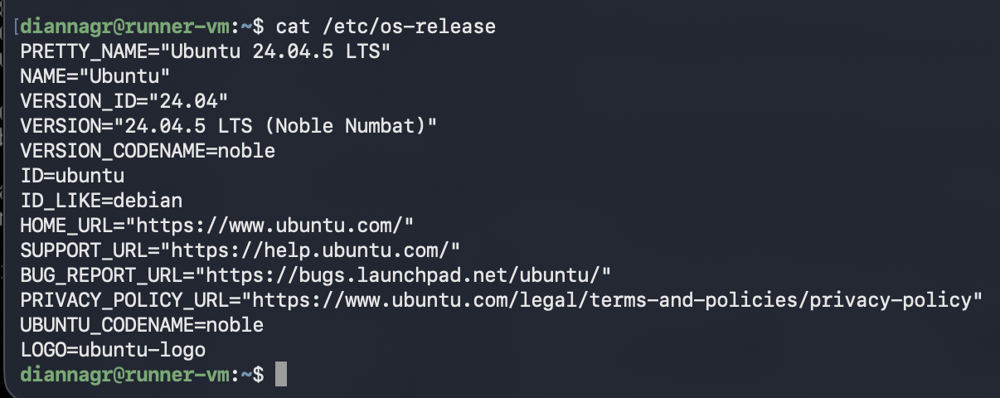
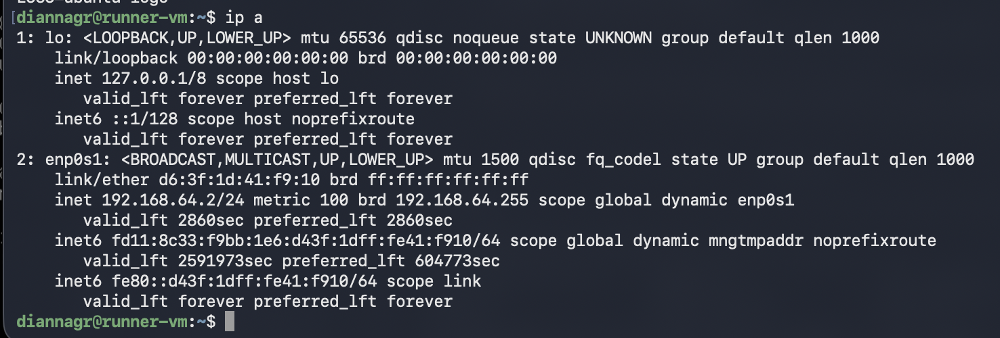
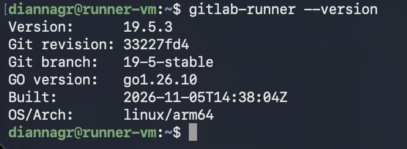
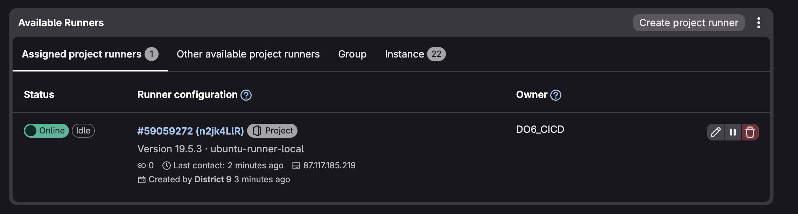
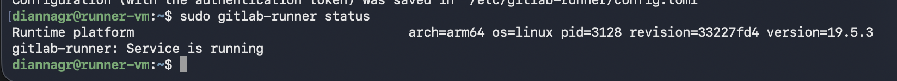

## Part 1. Настройка gitlab-runner

Для выполнения задания была развернута виртуальная машина с операционной системой Ubuntu Server 24.04 LTS (ARM64) с использованием виртуализации UTM (QEMU). Сеть настроена в режиме Shared Network (виртуальный адаптер получает IP-адрес 192.168.64.2).

На виртуальную машину установлен и настроен `gitlab-runner` с исполнителем `shell`. Регистрация выполнена для текущего проекта (DO6_CICD). Runner успешно подключен к GitLab и находится в статусе online.

- Проверка версии ОС:
  

- IP-адрес виртуальной машины:
  

- Проверка установленной версии gitlab-runner:
  

- Статус runner в GitLab:
  

- Статус службы gitlab-runner в системе:
  