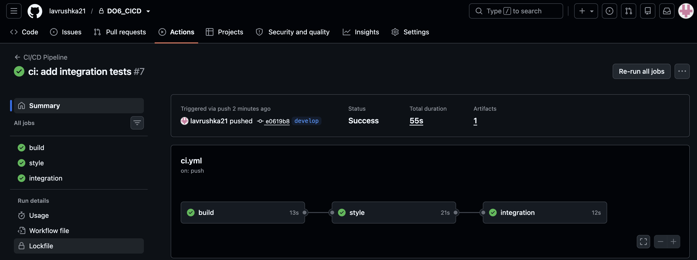
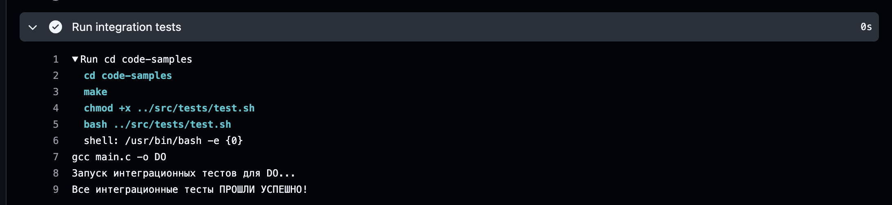
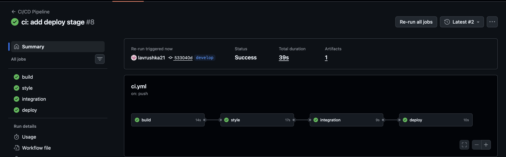
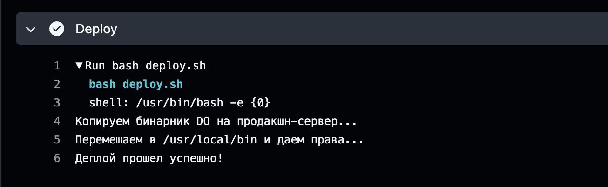
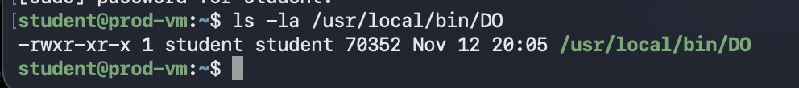

## Part 1. Настройка gitlab-runner

Для выполнения задания была развернута виртуальная машина с операционной системой **Ubuntu Server 24.04 LTS (ARM64)** с использованием виртуализации **UTM** (движок QEMU). Сеть настроена в режиме Shared Network, виртуальная машина получила IP-адрес `192.168.64.2`.

На виртуальную машину установлен и настроен **gitlab-runner** с исполнителем `shell`. Регистрация выполнена для текущего проекта (DO6_CICD). Runner успешно подключен к GitLab и находится в статусе online.

- Проверка версии ОС:
  

- IP-адрес виртуальной машины:
  

- Проверка установленной версии gitlab-runner:
  

- Статус службы gitlab-runner в системе:
  

- Статус runner в GitLab (online):
  

## Part 2. Сборка

В файл `.github/workflows/ci.yml` добавлен этап `build`, который автоматически запускает сборку приложения из папки `code-samples` (утилита DO). Артефакт сборки (бинарник `DO`) сохраняется в GitHub на 30 дней.

Пайплайн успешно проходит этап сборки.

- Успешный пайплайн со стадией сборки:
  

- Лог выполнения сборки (компиляция без ошибок):
  

- Сохраненные артефакты (бинарник DO):
  
  

## Part 3. Тест кодстайла

В файл `.github/workflows/ci.yml` добавлен этап `style`, который запускает проверку форматирования кода с помощью утилиты `clang-format`. Этап зависит от успешной сборки (`needs: build`), поэтому запускается только после неё.

Если код не соответствует стандартам, утилита возвращает ненулевой код выхода, и пайплайн завершается с ошибкой (красный статус).

- Успешный пайплайн со стадиями сборки и стиля:
  

- Лог проверки кодстайла:
  

## Part 4. Интеграционные тесты

В файл `.github/workflows/ci.yml` добавлен этап `integration`, который запускает интеграционные тесты. Тесты написаны на языке Bash и находятся в файле `src/tests/test.sh`. Они вызывают собранное приложение `DO` с разными аргументами и проверяют корректность его вывода.

Этап запускается автоматически только при условии успешного прохождения этапов сборки и кодстайла (`needs: [build, style]`). Если тесты не проходят, скрипт возвращает код ошибки, и пайплайн «фейлится» (становится красным).

- Успешный пайплайн со всеми тремя стадиями (build, style, integration):
  

- Лог успешного прохождения интеграционных тестов:
  

# Part 5. Этап деплоя

Для выполнения этапа CD была поднята **вторая виртуальная машина** Ubuntu Server 24.04 LTS (production) с IP-адресом `192.168.64.3`. 

**Настройка окружения (без скриншотов):**
1.  На первой машине (runner) был сгенерирован SSH-ключ (`ssh-keygen`).
2.  Публичный ключ был скопирован на вторую машину в файл `~/.ssh/authorized_keys` для обеспечения беспарольного доступа.
3.  На второй машине был настроен `sudoers` (через `visudo`), чтобы пользователь `student` мог выполнять команды `mv` и `chmod` в `/usr/local/bin` без ввода пароля (необходимо для работы CI/CD).

Написан bash-скрипт `deploy.sh`, который с помощью `scp` копирует собранный бинарник `DO` на вторую виртуальную машину, а с помощью `ssh` перемещает его в директорию `/usr/local/bin` и выдает права на выполнение.

В файл `.github/workflows/ci.yml` добавлен этап `deploy`, который запускается только после успешного прохождения всех предыдущих этапов (`needs: [build, style, integration]`).

- Успешный пайплайн с этапом деплоя:
  

- Лог успешного деплоя (скрипт отработал):
  

- Проверка наличия бинарника на production-сервере (права на выполнение):
  