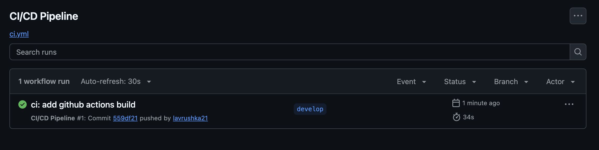
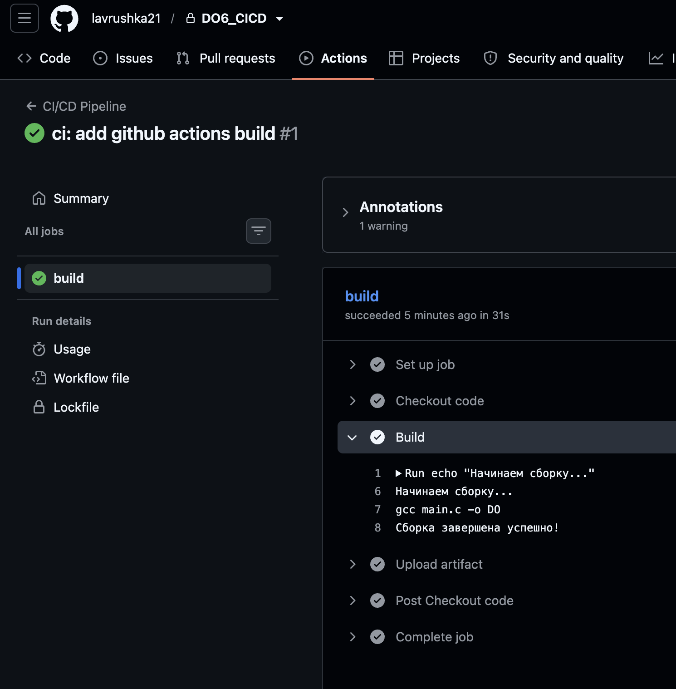
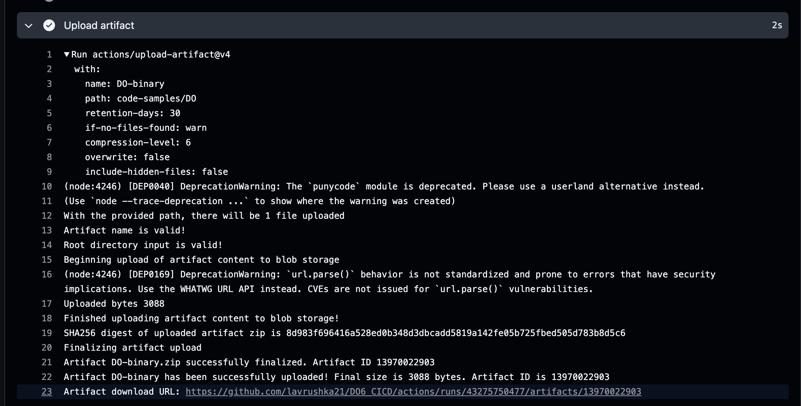
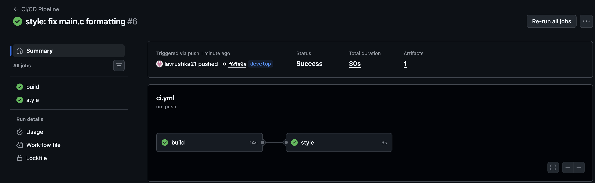
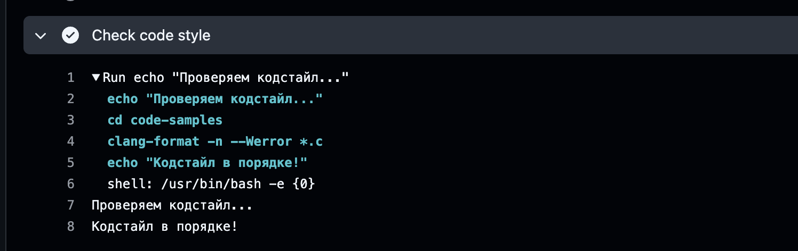

## Part 1. Настройка gitlab-runner

Для выполнения задания была развернута виртуальная машина с операционной системой **Ubuntu Server 24.04 LTS (ARM64)** с использованием виртуализации **UTM** (движок QEMU). Сеть настроена в режиме Shared Network, виртуальная машина получила IP-адрес `192.168.64.2`.

На виртуальную машину установлен и настроен **gitlab-runner** с исполнителем `shell`. Регистрация выполнена для текущего проекта (DO6_CICD). Runner успешно подключен к GitLab и находится в статусе online.

- Проверка версии ОС:
  

- IP-адрес виртуальной машины:
  

- Проверка установленной версии gitlab-runner:
  

- Статус службы gitlab-runner в системе:
  

- Статус runner в GitLab (online):
  

## Part 2. Сборка

В файл `.github/workflows/ci.yml` добавлен этап `build`, который автоматически запускает сборку приложения из папки `code-samples` (утилита DO). Артефакт сборки (бинарник `DO`) сохраняется в GitHub на 30 дней.

Пайплайн успешно проходит этап сборки.

- Успешный пайплайн со стадией сборки:
  

- Лог выполнения сборки (компиляция без ошибок):
  

- Сохраненные артефакты (бинарник DO):
  
*Пояснение:* В отличие от GitLab, где артефакты отображаются отдельным блоком в интерфейсе, в GitHub Actions информация о загрузке артефакта выводится в логе шага `Upload artifact`. На скриншоте видно, что артефакт `DO-binary` успешно загружен (Final size: 3088 bytes) и получена прямая ссылка (Artifact download URL) для его скачивания. Это подтверждает, что бинарник сохранен и доступен.

## Part 3. Тест кодстайла

В файл `.github/workflows/ci.yml` добавлен этап `style`, который запускает проверку форматирования кода с помощью утилиты `clang-format`. Этап зависит от успешной сборки (`needs: build`), поэтому запускается только после неё.

Если код не соответствует стандартам, утилита возвращает ненулевой код выхода, и пайплайн завершается с ошибкой (красный статус).

- Успешный пайплайн со стадиями сборки и стиля:
  

- Лог проверки кодстайла:
  